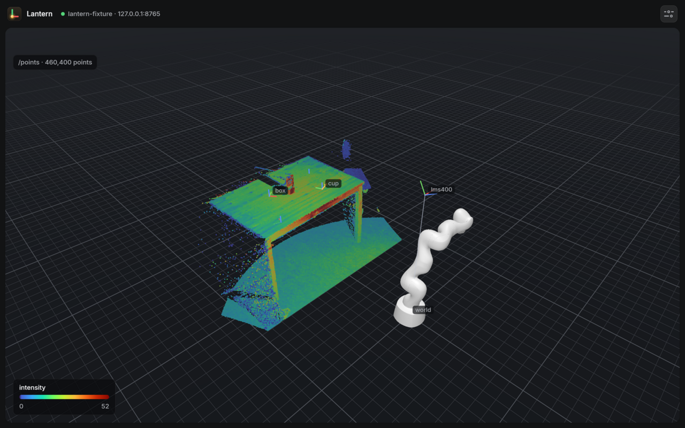

# Lantern

A small RViz stand-in in Rust. It draws point clouds, TF, poses, a robot model and camera images
from foxglove_bridge or any Foxglove SDK app. Linux only; needs a GPU with a Vulkan driver.



```sh
curl -fsSL https://raw.githubusercontent.com/matthewyjiang/lantern/main/scripts/install.sh | sh
```

Docs: [matthewyjiang.github.io/lantern](https://matthewyjiang.github.io/lantern/)
