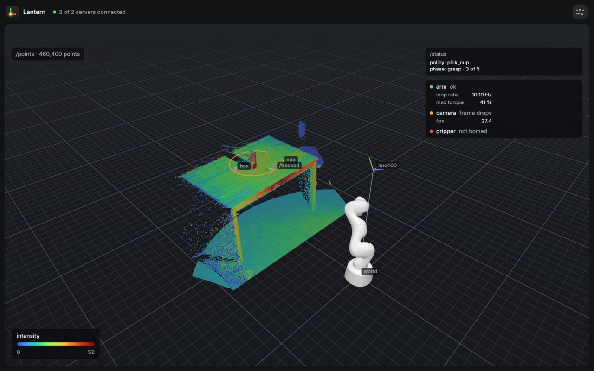
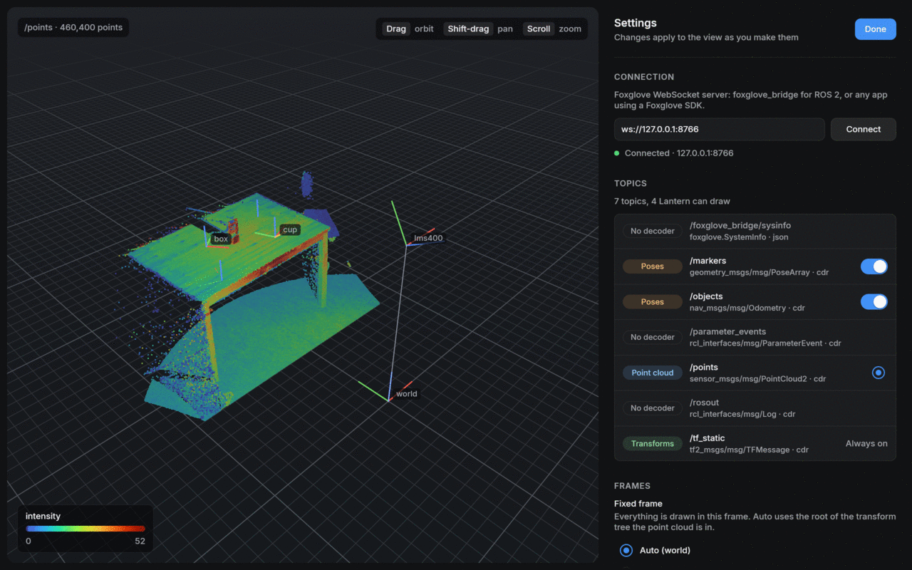

Lantern is a client of the
[Foxglove WebSocket protocol](https://github.com/foxglove/foxglove-sdk/blob/main/docs/spec/websocket/README.md).
Anything that serves it is a source: foxglove_bridge on ROS 2, or a program using a Foxglove SDK.
Lantern only subscribes to the topics it's drawing. If the view stays empty, the
[status chip](/lantern/getting-started/#the-status-chip) says why.

## Servers

The default server is `ws://localhost:8765`, the default port of foxglove_bridge and the SDKs. To
add another, open **Settings → Connections**, type its URL (for example `ws://192.168.1.20:8765`)
and press **Add** (or Enter). Lantern reads every server in the list at once, so a robot's bridge and an app
on another machine can feed the same view. The list is saved with your
[settings](/lantern/guides/settings/).



[`--connect`](/lantern/guides/settings/#command-line) replaces the list for one run:

```sh
lantern --connect ws://robot:8765 --connect ws://localhost:8765
```

Lantern doesn't support TLS (`wss://`). On a network you don't trust, tunnel the port over SSH and
keep the default URL:

```sh
ssh -N -L 8765:localhost:8765 robot
```

## ROS 2: foxglove_bridge

Run [foxglove_bridge](https://github.com/foxglove/foxglove-sdk/tree/main/ros/src/foxglove_bridge)
next to your nodes:

```sh
sudo apt install ros-$ROS_DISTRO-foxglove-bridge
ros2 run foxglove_bridge foxglove_bridge
```

The bridge forwards ROS 2 messages in CDR, and Lantern decodes them itself, so the machine running
Lantern doesn't need ROS. The bridge listens on every interface on port 8765. Add
`--ros-args -p address:=127.0.0.1` to keep it on loopback (for an SSH tunnel), or
`-p port:=9090` to change the port. Lantern speaks both the newer SDK-based bridge's subprotocol
(`foxglove.sdk.v1`) and the older one (`foxglove.websocket.v1`).



[Supported topics](/lantern/reference/topics/) lists the message types Lantern reads.

## Your own program

A program that doesn't use ROS can serve the protocol itself with a
[Foxglove SDK](https://github.com/foxglove/foxglove-sdk) (Python, C++ or Rust).
[Publish from your code](/lantern/guides/publishing/) shows how.

## No robot: the replay server

[The replay server](/lantern/reference/replay-server/) in the repository serves recorded scans,
a robot's joint states, a camera image and status topics, for trying Lantern without a robot.
