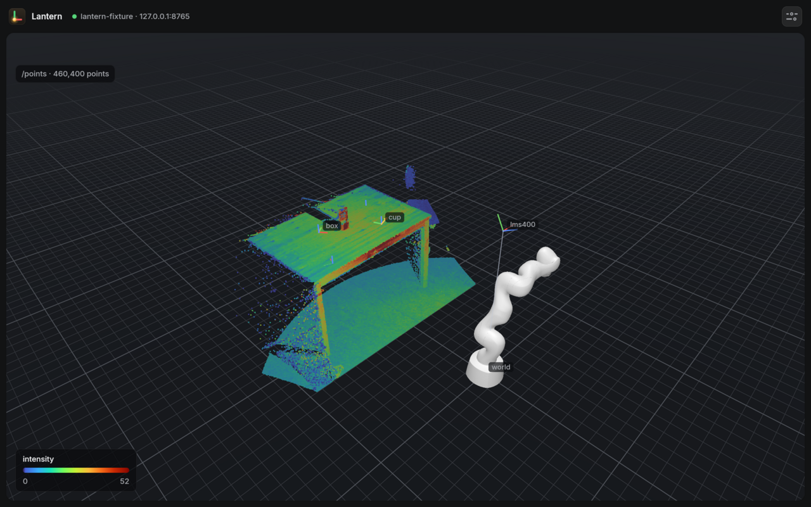

Lantern is a single Linux binary. It needs a GPU with a Vulkan driver and a Wayland or X11
desktop. It doesn't need ROS, even when the data comes from ROS.

## Install a release

On x86_64 or aarch64 Linux:

```sh
curl -fsSL https://raw.githubusercontent.com/matthewyjiang/lantern/main/scripts/install.sh | sh
```

The script downloads the latest release, checks its SHA-256, and puts `lantern` in
`~/.local/bin`. `LANTERN_VERSION` picks a release and `LANTERN_INSTALL_DIR` changes where it goes:

```sh
curl -fsSL https://raw.githubusercontent.com/matthewyjiang/lantern/main/scripts/install.sh \
    | LANTERN_VERSION=v0.1.0 LANTERN_INSTALL_DIR="$HOME/bin" sh
```

The binary needs glibc 2.35 or newer (Ubuntu 22.04, Debian 12). It loads Vulkan, fontconfig,
xkbcommon and the windowing libraries at startup, so those must be installed: on X11, that's
libX11, libXcursor, libXi and libxkbcommon-x11; on Wayland, libwayland. The
archives are also on the
[releases page](https://github.com/matthewyjiang/lantern/releases).

## Build from source

You need Rust 1.88 or newer, a C compiler, and the same run-time libraries. On Arch:

```sh
sudo pacman -S --needed base-devel git rustup vulkan-icd-loader fontconfig libxkbcommon
rustup default stable
```

Add the Vulkan driver for your GPU: `vulkan-radeon` (AMD), `vulkan-intel` (Intel) or
`nvidia-utils` (NVIDIA). `vulkaninfo --summary`, from `vulkan-tools`, should list your GPU.
Lantern only uses wgpu's Vulkan backend, so without a Vulkan driver it opens no window.

```sh
git clone https://github.com/matthewyjiang/lantern.git
cd lantern
cargo install --locked --path .    # installs lantern to ~/.cargo/bin
```

To run from the checkout instead, use `cargo run --release -- <flags>`. Build in release mode: a
debug build renders much more slowly. The first build fetches
[Rune](https://github.com/anomalyco/rune), Lantern's UI library, from git and compiles wgpu, so it
takes a while.

## The window

Run `lantern`. It connects to `ws://localhost:8765`. Until something answers there, the status
chip over the viewport says `Can't reach ws://localhost:8765: …` and Lantern retries every second,
so you can start the [source](/lantern/connect/) before or after it.



| Input | Action |
| --- | --- |
| Drag | Orbit |
| Shift-drag or middle-drag | Pan |
| Scroll | Zoom |

The top of the side panel shows the connection. Below it:

- **Displays:** grid, point cloud, TF frames and poses, plus camera image, text and stats when a
  server offers them.
- **Point cloud:** colour, point size and density.
- **Robot:** visibility and opacity, once a robot model is loaded.
- **Camera:** **Reset view** and **Top down**.

The slider button opens the [Settings page](/lantern/guides/settings/) for everything else:
servers, topics, the fixed frame, poses and the robot. The tiles button next to it
[edits the panel layout](/lantern/guides/layout/).

[Flags](/lantern/guides/settings/#command-line) set the servers, robot and layout for one run:

```sh
lantern --connect ws://a:8765 --connect ws://b:8765 --urdf robot.urdf --layout dashboard
```

## The status chip

The status chip over the viewport says why the view is empty or incomplete:

| Chip | Meaning |
| --- | --- |
| `No servers: add one in Settings` | The server list is empty. |
| `Connecting to ws://…` | Nothing has answered yet. An unreachable host shows this for 3 s. |
| `Can't reach ws://…: …` | The connection failed or dropped. Lantern retries every second. |
| `Connected; the server offers no topics yet` | The server is up but hasn't advertised anything. |
| `/points: no transform from lidar to world` | TF doesn't connect the data's frame to the fixed frame yet. |
| `Server: …` | A warning from the server, such as a failed subscription. |
| `/camera/image: …` | The image didn't decode or is over the size limit. |
| `Robot: …` | The URDF file didn't load, or doesn't match the robot a server describes. See [Robot model](/lantern/guides/robot-model/#from-the-server). |
| `Robot from /robot_description: …` | The URDF a server sent didn't load. |

With several servers, the chip has separate lines for the connections, the robot and the data, so
one offline server doesn't hide problems with the others. Topics Lantern can't decode are still
listed in **Settings → Topics**, marked **No decoder**.
