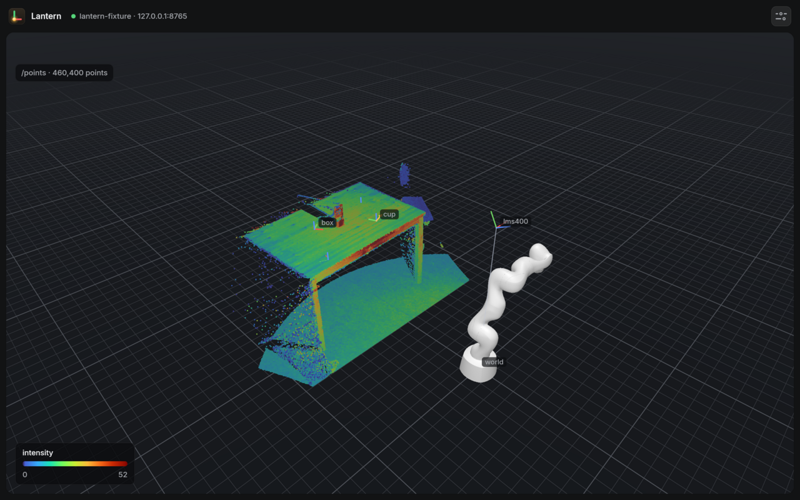

import { Aside, Steps } from '@astrojs/starlight/components';

[kpd](https://github.com/lunarlab-gatech/kuka-policy-deployment) runs learned policies on the
KUKA LBR Med, in simulation or over FRI, and doesn't use ROS. Lantern was built so kpd can show
its robot next to what it perceives (point clouds, tracked objects, fiducials) by serving the
Foxglove protocol straight from Python with the
[Foxglove Python SDK](https://pypi.org/project/foxglove-sdk/).

<Aside type="note" title="Status">
	kpd doesn't publish to Lantern yet; it renders with viser. This page is the recipe for wiring it
	up. Lantern's decoders, the replay server and the Med 7 fixture already speak exactly this
	shape.
</Aside>

## What to publish

| Topic | Channel | Lantern draws |
| --- | --- | --- |
| `/tf` | `FrameTransformsChannel` | The TF tree: where the camera and the robot base sit in `world` |
| `/joint_states` | JSON channel (below) | The arm, posed by the URDF |
| `/objects` | `OdometryChannel` | One labelled pose per tracked object, with a 1 s velocity arrow |
| `/markers` | `PosesInFrameChannel` | Unlabelled poses, e.g. ArUco detections |
| `/points` | `PointCloudChannel` | The camera's point cloud |

The topic names are free; Lantern picks channels by schema, not name.

## Serve from kpd

<Steps>

1. Add the SDK to kpd's environment.

   ```sh
   uv add foxglove-sdk
   ```

2. Start the server once, before the control loop.

   ```python
   import foxglove

   # 127.0.0.1 by default. 0.0.0.0 lets Lantern on another machine connect.
   foxglove.start_server(name="kpd", host="0.0.0.0", port=8765)
   ```

3. Create the channels and log to them from wherever kpd has the data.

   ```python
   from foxglove import messages as fm
   from foxglove.channels import FrameTransformsChannel, OdometryChannel, PointCloudChannel, PosesInFrameChannel

   tf = FrameTransformsChannel("/tf")
   objects = OdometryChannel("/objects")
   markers = PosesInFrameChannel("/markers")
   points = PointCloudChannel("/points")

   tf.log(fm.FrameTransforms(transforms=[
       fm.FrameTransform(parent_frame_id="world", child_frame_id="camera", translation=..., rotation=...),
   ]))

   # One message per tracked object. body_frame_id is the label Lantern draws. The velocity is in
   # the body frame, as foxglove.Odometry defines it, and is drawn as a 1 s arrow.
   objects.log(fm.Odometry(frame_id="world", body_frame_id=obj.name, pose=..., linear_velocity=...))

   markers.log(fm.PosesInFrame(frame_id="camera", poses=[...]))
   points.log(fm.PointCloud(frame_id="camera", point_stride=16, fields=[...], data=...))
   ```

</Steps>

Lantern draws the newest message on each topic, and for `/objects`, the newest per object
(`body_frame_id`), so every tracked object stays on screen. Log each message in whatever frame you
have it in; TF places it in the fixed frame.

## Joint states

Foxglove has no joint-state schema. Declare a JSON channel whose schema `title` is
`sensor_msgs/msg/JointState`. The SDK sends the title as the schema name, which is what Lantern
matches, and Lantern reads `name` and `position`:

```python
joints = foxglove.Channel("/joint_states", schema={
    "title": "sensor_msgs/msg/JointState",
    "type": "object",
    "properties": {
        "name": {"type": "array", "items": {"type": "string"}},
        "position": {"type": "array", "items": {"type": "number"}},
    },
})

# Every control tick, in radians.
joints.log({"name": [f"lbr_joint_{k}" for k in range(7)], "position": list(q)})
```

The names must match the URDF's joints: `lbr_joint_0` to `lbr_joint_6` for the Med 7. Lantern
draws the newest message, so logging every tick of kpd's 100 Hz loop is fine.

## Load the Med 7

Lantern reads URDF from disk, not from a topic. Expand kpd's xacro once with the repo's fixture
script, which uses xacro from kpd's `.venv` and copies the visual meshes next to the URDF:

```sh
python scripts/robot_fixture.py ~/path/to/kuka-policy-deployment
```

Then load `fixtures/med7/med7.urdf` in **Settings → Robot**. Its root link is `world`, so the
arm stands at the origin of the `world` frame your transforms use. See the
[Robot model guide](/lantern/guides/robot-model/) for the details.



## Check it without the robot

[`scripts/serve.py`](https://github.com/matthewyjiang/lantern/blob/main/scripts/serve.py) serves
this same shape with fixed data: the table scan, two objects named like kpd's (`cup` and
`box`), two markers, and the Med 7's joints at `HOME_Q`. It's a complete working example of
everything on this page:

```sh
/tmp/fxenv/bin/python scripts/serve.py --cloud table --robot-pose home
```

Setup for `/tmp/fxenv` is in [Connect a source](/lantern/connect/#no-robot-the-replay-server).
