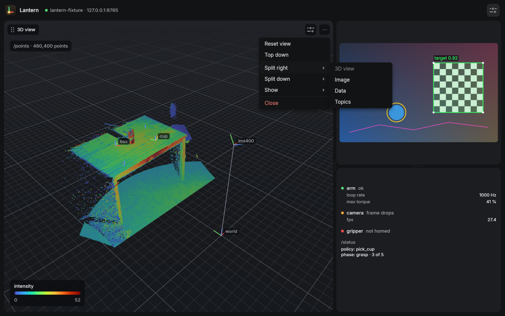
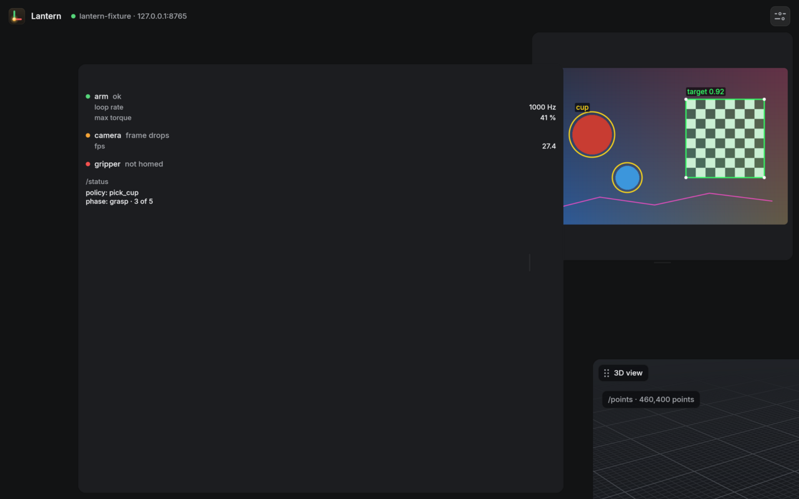

The window under the top bar is a layout of panels, starting as a single 3D view. Each panel keeps
its own settings in the layout. The layout is saved with your settings, and can also be saved to a
file and loaded with `--layout`.


## Panels

| Panel | In a file | Shows |
| --- | --- | --- |
| **3D view** | `3d` | Point cloud, TF, poses and the robot, with the status chip and colour legend |
| **Image** | `image` | A camera image and its annotations |
| **Data** | `data` | Stats topics' statuses, then text topics' newest messages |
| **Topics** | `topics` | Every advertised topic, the list from [Settings → Topics](/lantern/guides/settings/#topics) |

A layout has at most one 3D view; the other panels can appear more than once, so two Image panels
can show two cameras, or the same camera with different annotations. Without an Image or Data
panel, the 3D view draws the image, text and stats as [cards](/lantern/guides/settings/#3d-view).

## Edit the layout



Point at a panel to show its header: its name, its
[settings](/lantern/guides/settings/#panel-settings) button and its **⋯** menu, which has:

- **Reset view** and **Top down**, on the 3D view only.
- **Split right** and **Split down**, each with a submenu of panel types: the new panel takes half
  of this one's space, with that type's default settings. **3D view** is greyed out when the layout
  already has one.
- **Show** changes what the panel shows, with the new type's default settings. Picking **3D view**
  where another panel has it swaps the two, each with its settings.
- **Close** removes the panel; its neighbours take the space. The last panel can't be closed.

Drag a panel by its name to move it: it swaps places with each panel it passes over, each keeping
its settings. Let go to drop it, or press Escape to put everything back.



Drag the gap between two panels to resize them.

## Presets

**Settings → Layout** has three presets, and `--layout` accepts the same names:

| Preset | Layout |
| --- | --- |
| `3d` | The 3D view alone (the default) |
| `camera` | The 3D view, with the image on the right |
| `dashboard` | The 3D view, with the image above a Data panel on the right |

Picking a preset carries over the settings of matching panels from the current layout, matched by
type in order: choosing `camera` keeps your robot. A preset is highlighted when the tiling matches,
whatever the panels' settings.

## Layout files

A layout file is JSON. Each node is a panel, or a `row` or `column` of nodes:

```json title="layout.json"
{
  "row": [
    { "panel": "3d", "weight": 2, "robot": { "urdf": "/path/arm.urdf" } },
    {
      "column": [
        { "panel": "image", "topic": "/cam/left" },
        { "panel": "image", "topic": "/cam/right", "hidden": ["/cam/right/detections"] }
      ]
    }
  ]
}
```

- `panel` is `3d`, `image`, `data` or `topics`.
- `row` places nodes left to right; `column` stacks them top to bottom.
- `weight` is the node's share of its row or column, 1 by default.
- The other keys beside `panel` are its settings, listed in
  [Panel keys](/lantern/guides/settings/#panel-keys). A key left out takes its default, and saving
  writes only the settings that differ from the defaults.
- The 3D view's `objects.meshes` attaches mesh files to TF frames, for fixtures no topic sends; see
  [Meshes in the layout](/lantern/guides/objects/#meshes-in-the-layout).

To save the layout, type a path into **Layout file** in **Settings → Layout** and press **Save**.
**Load** reads a file, used as it is, or a preset name. For one run:

```sh
lantern --layout layout.json
```

A name that matches a preset picks the preset, so write `./camera` for a file named `camera`.

A file with a mistake isn't loaded, and the error says where, for example
`layout.row[1]: no panel called "plot" (the panels are 3d, image, data, topics)`. A bad setting
gives ``layout.row[1]: invalid type: integer `3`, expected a string``, or
``layout: unknown field `size`, expected one of …``. With `--layout` Lantern prints the error and
exits; with **Load** it shows the error and keeps the current layout.

The `layout` key of [`settings.json`](/lantern/guides/settings/#settingsjson) uses the same format.
