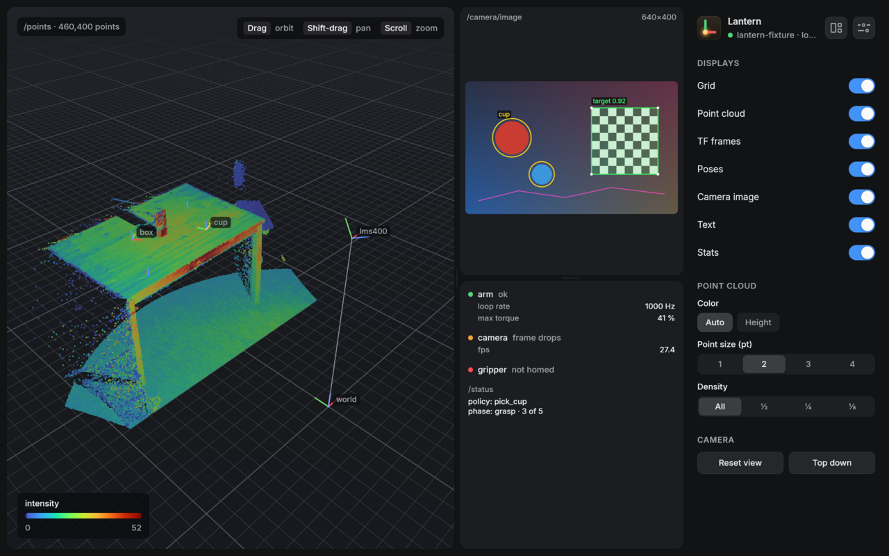
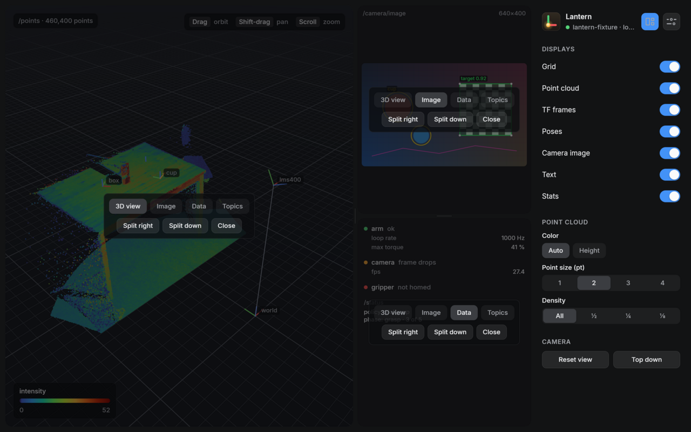

import { Aside } from '@astrojs/starlight/components';

The window beside the side panel is a layout of panels. Lantern starts with one, the 3D view. You
can split it, choose what each panel shows, and resize the panels against each other. The layout
is saved with your settings, and it can live in a file of its own that you pass on the command
line.



That's the `dashboard` preset, from `--layout dashboard`.

## Panels

| Panel | Name in a file | Shows |
| --- | --- | --- |
| **3D view** | `3d` | The viewport: point cloud, TF, poses and the robot, with the status chip and colour legend. |
| **Image** | `image` | The camera image with its annotations, as large as fits the panel. |
| **Data** | `data` | Every stats topic's statuses with their readings, then every text topic's newest message. It scrolls. |
| **Topics** | `topics` | Every topic the servers advertise, with the same controls as [Settings → Topics](/lantern/guides/settings/#topics). |

A layout has at most one 3D view. The other panels can appear any number of times.

Panels show what the rest of Lantern is set to show. The Image panel shows the image topic picked
in Settings, and the **Camera image**, **Text** and **Stats** switches in the side panel turn
their panels' content off too.

While a layout has no Image panel, the 3D view keeps the camera image as a card in its corner;
while it has no Data panel, it keeps the text and stats cards. Add the panel and its card leaves
the 3D view.

## Arrange the panels

Drag the gap between two panels to resize them. This works at any time.

For everything else, press the **Edit layout** button at the top of the side panel (the tiles
icon, next to the settings button), or switch on **Edit layout** in Settings → Layout. Each panel
then shows its controls:



- **3D view, Image, Data, Topics** set what the panel shows. Picking **3D view** where another
  panel already has it swaps the two.
- **Split right** and **Split down** halve the panel and put a new one beside or below it. The
  new panel shows the first type the layout doesn't have yet.
- **Close** removes the panel, and its neighbours take the space. The last panel has no
  **Close**.

Press **Edit layout** again when you're done. Every change is saved as you make it, so Lantern
opens the next time with the same layout.

## Presets

Settings → Layout offers three layouts to start from. `--layout` takes the same names.

| Preset | Layout |
| --- | --- |
| `3d` | The 3D view alone. This is the default. |
| `camera` | The 3D view, with the image to its right. |
| `dashboard` | The 3D view, with the image above a Data panel to its right. |

## Layout files

A layout file is JSON. A node is either a panel or a `row` or `column` of nodes:

```json title="layout.json"
{
  "row": [
    { "panel": "3d", "weight": 2 },
    {
      "column": [
        { "panel": "image" },
        { "panel": "data" }
      ]
    }
  ]
}
```

- `"panel"` is one of `3d`, `image`, `data` and `topics`.
- `"row"` places its nodes side by side, left to right. `"column"` stacks them, top to bottom.
- `"weight"` is the node's share of its row or column, and is 1 when left out. Above, the 3D view
  is twice as wide as the column next to it.

To write one, arrange the panels, type a path into **Layout file** in Settings → Layout and press
**Save**. **Load** reads the file back, and also takes a preset's name.

Start Lantern with a layout file, or a preset, for one run:

```sh
cargo run --release -- --layout layout.json
cargo run --release -- --layout dashboard
```

The same file always gives the same layout. A name that matches a preset picks the preset, so
write `./camera` for a file called `camera`.

`--layout` works like `--connect` and `--urdf`: it isn't saved. If you change the layout during
that run, your change is saved as usual.

<Aside type="note">
	A layout file with a mistake isn't loaded. Lantern says what is wrong and where, for example
	`layout.row[1]: no panel called "plot" (the panels are 3d, image, data, topics)`. From
	`--layout` it prints that and exits; from **Load** it shows it under the field and keeps the
	current layout.
</Aside>

The layout is also the `layout` key of
[`settings.json`](/lantern/guides/settings/#settingsjson), in the same format.

To add a panel type of your own, see
[Add a panel type](/lantern/reference/architecture/#add-a-panel-type).
