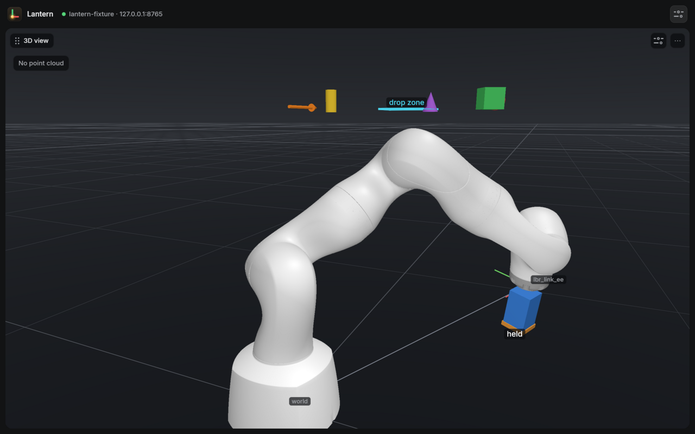
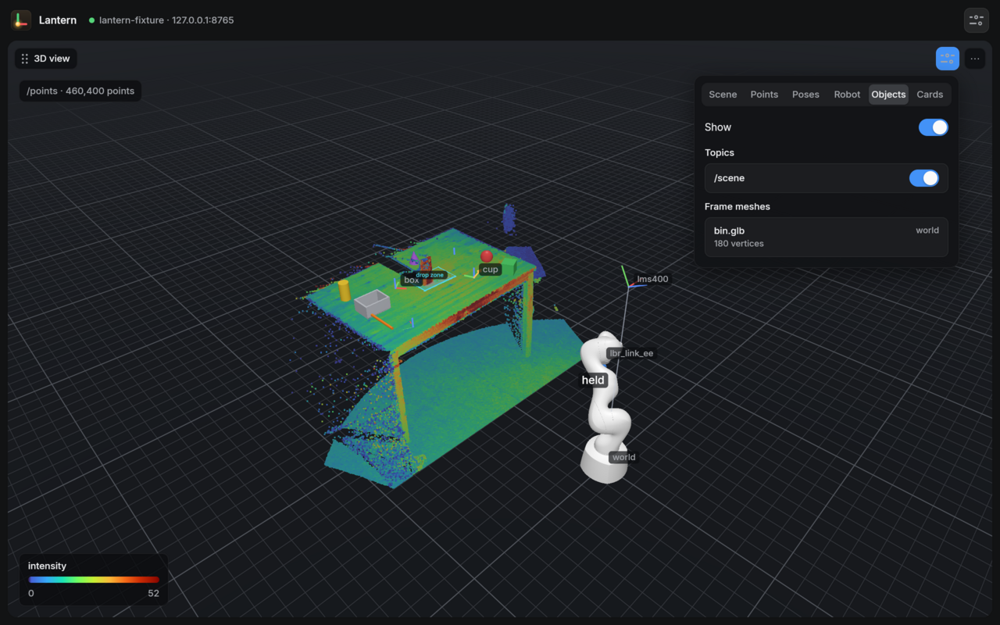

The 3D view draws Foxglove `SceneUpdate` messages: entities made of cubes, spheres, cylinders,
arrows, lines, triangles, text and meshes, each placed in a TF frame. An object in a gripper is an
entity in the gripper's frame, so it moves with the arm.



To try it, run the [replay server](/lantern/reference/replay-server/) with
`--robot-pose reach --objects` and load the Med 7
([Robot model](/lantern/guides/robot-model/#try-it-with-the-med-7)).

## Publish a scene

With the [Python SDK](/lantern/guides/publishing/):

```python title="grasp.py"
import foxglove
from foxglove import messages as fm
from foxglove.channels import SceneUpdateChannel

foxglove.start_server(name="my-app", port=8765)
scene = SceneUpdateChannel("/scene")
cup = open("cup.glb", "rb").read()

def pose(x, y, z):
    return fm.Pose(position=fm.Vector3(x=x, y=y, z=z), orientation=fm.Quaternion(x=0, y=0, z=0, w=1))

scene.log(fm.SceneUpdate(entities=[
    # Held: 7 cm along the gripper frame's z.
    fm.SceneEntity(id="cup", frame_id="gripper_link", models=[
        fm.ModelPrimitive(pose=pose(0, 0, 0.07), scale=fm.Vector3(x=1, y=1, z=1), media_type="model/gltf-binary", data=cup),
    ]),
    fm.SceneEntity(id="target", frame_id="world", cubes=[
        fm.CubePrimitive(pose=pose(0.5, 0.2, 0.05), size=fm.Vector3(x=0.1, y=0.1, z=0.1), color=fm.Color(r=0.3, g=0.8, b=0.4, a=1)),
    ]),
]))
```

When the gripper lets go, send the cup again in `world`, or delete it:

```python
scene.log(fm.SceneUpdate(deletions=[fm.SceneEntityDeletion(type=fm.SceneEntityDeletionType.MatchingId, id="cup")]))
```

On ROS 2, publish `foxglove_msgs/msg/SceneUpdate` (`ros-humble-foxglove-msgs`) and
[foxglove_bridge](/lantern/connect/#ros-2-foxglove_bridge) forwards it.

The frame must be in TF. Lantern poses its robot model from joint states but doesn't publish the
links as TF frames, so run `robot_state_publisher` (or send the transform yourself) for an entity
in a link's frame.

## Entities

- Entities are kept per topic, by `id`. An entity with the same `id` replaces the old one.
- Deletions (by `id`, or all of the topic's) apply before the update's entities.
- An entity with a `lifetime` goes that long after it arrives; without one it stays until replaced
  or deleted. Its topic going away or being switched off removes its entities too.
- An entity always follows its frame as TF moves it. `frame_locked` is ignored.
- An entity whose frame has no transform to the fixed frame isn't drawn, and the status chip says so.

## Shapes

| Primitive | Drawn |
| --- | --- |
| Cubes, spheres | `size` across, along the pose's x, y and z |
| Cylinders | Along z; `bottom_scale` and `top_scale` scale each end, and 0 makes a cone |
| Arrows | From the pose along its +x: the shaft, then the head |
| Lines | Strip, loop or list, `thickness` in metres (in pixels with `scale_invariant`). With `colors`, each segment takes its first point's colour. `indices` are used when set. |
| Triangles | In one colour: `color`, or the first of `colors` |
| Texts | Facing the camera, centred on the pose. `font_size` is in points with `scale_invariant`, else metres (shown 6 to 72 pt). |
| Models | Meshes, below |


A primitive without a colour is transparent, as in Foxglove, and isn't drawn. Colours with alpha
below 1 are drawn translucent.

## Meshes

A `ModelPrimitive` sends the mesh in `data`, with its `media_type`, or names a file in `url`.

| Format | `media_type` | File |
| --- | --- | --- |
| GLB, glTF | `model/gltf-binary`, `model/gltf+json` | `.glb`, `.gltf` |
| STL, binary or ASCII | `model/stl` | `.stl` |

- Both formats are read as Y-up and turned to Z-up, as Foxglove does. (URDF meshes aren't turned.)
- A `url` is an absolute path, `file://` or `package://`, found like
  [URDF mesh paths](/lantern/guides/robot-model/#meshes), on Lantern's machine. HTTP URLs aren't
  fetched.
- glTF draws the default scene's triangles, placed by their nodes, each in its material's base
  colour. Textures and vertex colours aren't drawn. Buffers can be in the GLB, in `data:` URIs, or
  files beside a `.gltf` named by `url`.
- `override_color` draws the whole mesh in `color`. `scale` stretches it along each axis.
- Each file or distinct `data` is loaded once, when an entity first names it. A mesh that fails to
  load is reported in the status chip.

## Meshes in the layout

For fixtures no topic sends, such as a table or a bin, the 3D panel's `objects.meshes` in a
[layout file](/lantern/guides/layout/#layout-files) attaches mesh files to TF frames:

```json title="layout.json"
{
  "panel": "3d",
  "objects": {
    "meshes": [
      { "frame": "table", "file": "package://cell_description/meshes/bin.glb", "xyz": [0.4, 0, 0], "rpy": [0, 0, 1.5708] }
    ]
  }
}
```

| Key | Default | Meaning |
| --- | --- | --- |
| `frame` | | The TF frame |
| `file` | | A GLB, glTF or STL file, read as `url` is; a relative path is from Lantern's working directory |
| `xyz` | `[0, 0, 0]` | Offset from the frame, in metres |
| `rpy` | `[0, 0, 0]` | Roll, pitch and yaw about the frame's fixed axes, in radians, as in a URDF `origin` |
| `scale` | `[1, 1, 1]` | Along each axis |
| `color` | | `[r, g, b, a]`, 0 to 1, replacing the file's colours |

## Settings

The 3D view's **Objects** tab has **Show**, a switch per scene topic, and the layout's meshes with
their vertex counts or load errors. Only topics switched on are subscribed to. **Show** off hides
the layout's meshes too.



## Limits

- All objects share one mesh of up to 5,592,405 vertices
  ([limits](/lantern/reference/topics/#limits)). Shapes past it aren't drawn, and the status chip
  gives the count.
- Not supported: OBJ and DAE meshes, textures, HTTP URLs, and entities fixed in place while their
  frame moves (`frame_locked: false`).
