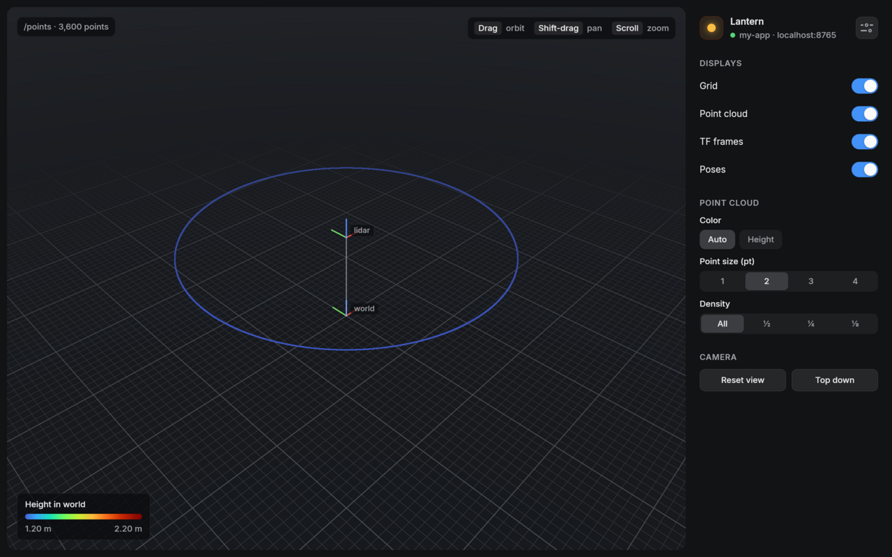

Your program can feed Lantern directly by serving the
[Foxglove WebSocket protocol](https://github.com/foxglove/foxglove-sdk/blob/main/docs/spec/websocket/README.md)
with a [Foxglove SDK](https://github.com/foxglove/foxglove-sdk) (Python, C++ or Rust). The examples
here use the [Python SDK](https://pypi.org/project/foxglove-sdk/). If your stack already runs ROS 2,
use [foxglove_bridge](/lantern/connect/#ros-2-foxglove_bridge) instead.

## A first point cloud

```sh
pip install foxglove-sdk
```

```python title="ring.py"
import math
import struct
import time

import foxglove
from foxglove import messages as fm
from foxglove.channels import FrameTransformsChannel, PointCloudChannel

foxglove.start_server(name="my-app", port=8765)
tf = FrameTransformsChannel("/tf")
points = PointCloudChannel("/points")

# A 2 m ring of 3,600 points: x, y, z as float32, 12 bytes each.
F32 = fm.PackedElementFieldNumericType.Float32
fields = [fm.PackedElementField(name=n, offset=4 * i, type=F32) for i, n in enumerate("xyz")]
ring = [(2 * math.cos(a), 2 * math.sin(a), 0.0) for a in (k * math.tau / 3600 for k in range(3600))]
data = b"".join(struct.pack("<fff", *p) for p in ring)

while True:
    tf.log(fm.FrameTransforms(transforms=[
        fm.FrameTransform(
            parent_frame_id="world",
            child_frame_id="lidar",
            translation=fm.Vector3(x=0.0, y=0.0, z=1.2),
            rotation=fm.Quaternion(x=0.0, y=0.0, z=0.0, w=1.0),
        )
    ]))
    points.log(fm.PointCloud(frame_id="lidar", point_stride=12, fields=fields, data=data))
    time.sleep(0.1)
```

Run `python ring.py` and Lantern draws the ring 1.2 m above `world`:



The server's `name` appears in the top bar. `start_server` listens on `127.0.0.1`
by default; pass `host="0.0.0.0"` to let Lantern connect from another machine.

## What to publish

| Topic | Channel | Lantern draws |
| --- | --- | --- |
| `/tf` | `FrameTransformsChannel` | The TF tree |
| `/points` | `PointCloudChannel` | A point cloud |
| `/objects` | `OdometryChannel` | One labelled pose per tracked object, with a velocity arrow |
| `/markers` | `PosesInFrameChannel` | Unlabelled poses, such as fiducial detections |
| `/joint_states` | `JointStatesChannel`, or JSON | The robot, posed from its URDF |
| `/robot_description` | JSON | The robot model itself |
| `/camera/image` | `CompressedImageChannel` or `RawImageChannel` | A camera image |
| `/camera/annotations` | `ImageAnnotationsChannel` | Shapes and labels over that image |
| `/status` | JSON | A text card |
| `/diagnostics` | JSON | Status lines in a stats card |

Publish only what you have. Lantern picks channels by schema, so topic names are up to you, with
one exception: a robot description's topic must be `robot_description` or end in
`/robot_description`.

Log each message in whatever frame you have it in; TF places it in the fixed frame. One odometry
topic can carry every tracked object, since Lantern keeps the newest message per `body_frame_id`:

```python
from foxglove.channels import OdometryChannel, PosesInFrameChannel

objects = OdometryChannel("/objects")
markers = PosesInFrameChannel("/markers")

# body_frame_id is the label. linear_velocity is in the body frame, drawn as a 1 s arrow.
objects.log(fm.Odometry(frame_id="world", body_frame_id=obj.name, pose=..., linear_velocity=...))
markers.log(fm.PosesInFrame(frame_id="camera", poses=[...]))
```

## Joint states

Use `foxglove.JointStates`:

```python
from foxglove.channels import JointStatesChannel

joints = JointStatesChannel("/joint_states")
joints.log(fm.JointStates(joints=[fm.JointState(name=n, position=q_i) for n, q_i in zip(joint_names, q)]))
```

Or send the ROS message as JSON. Lantern matches the schema name, which the SDK takes from the
schema's `title`, and reads `name` and `position`:

```python
joints = foxglove.Channel("/joint_states", schema={
    "title": "sensor_msgs/msg/JointState",
    "type": "object",
    "properties": {
        "name": {"type": "array", "items": {"type": "string"}},
        "position": {"type": "array", "items": {"type": "number"}},
    },
})

# Radians, or metres for prismatic joints.
joints.log({"name": joint_names, "position": list(q)})
```

Logging on every tick of a fast control loop is fine. See
[Joint states](/lantern/guides/robot-model/#joint-states) for how they're matched to the URDF.

## Text, stats and the robot description

Foxglove has no schema for these, so they also go out as JSON under the ROS type's name:

```python
def ros_json(topic, ros_type, properties):
    return foxglove.Channel(topic, schema={"title": ros_type, "type": "object", "properties": properties})

text = ros_json("/status", "std_msgs/msg/String", {"data": {"type": "string"}})
text.log({"data": "task: pick\nphase: grasp"})

diagnostics = ros_json("/diagnostics", "diagnostic_msgs/msg/DiagnosticArray", {"status": {"type": "array"}})
diagnostics.log({"status": [
    # level: 0 OK, 1 warning, 2 error, 3 stale.
    {"level": 1, "name": "camera", "message": "frame drops", "values": [{"key": "fps", "value": "27.4"}]},
]})

description = ros_json("/robot_description", "std_msgs/msg/String", {"data": {"type": "string"}})
description.log({"data": urdf_text})
```

The URDF's meshes must be on Lantern's machine; see
[Robot model](/lantern/guides/robot-model/#from-the-server).

## A complete example

[`scripts/serve.py`](https://github.com/matthewyjiang/lantern/blob/main/scripts/serve.py) publishes
all of the above with fixed data: a table scan, two tracked objects, two markers, a KUKA Med 7's
joints, a camera image with annotations, text and diagnostics.

```sh
/tmp/fxenv/bin/python scripts/serve.py --cloud table --robot-pose home --camera --status
```

[Replay server](/lantern/reference/replay-server/) has the setup.
