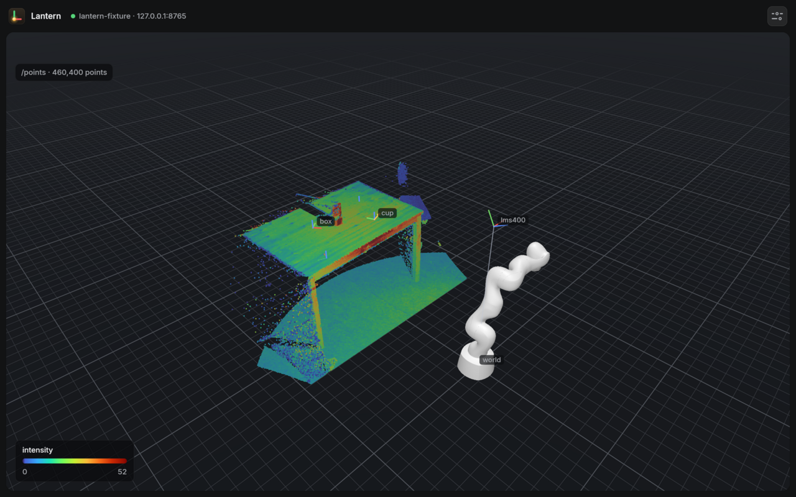

import { Steps } from '@astrojs/starlight/components';

Any program can feed Lantern by serving the
[Foxglove WebSocket protocol](https://github.com/foxglove/foxglove-sdk/blob/main/docs/spec/websocket/README.md)
itself. A [Foxglove SDK](https://github.com/foxglove/foxglove-sdk) (Python, C++ or Rust) does
the serving; your code logs messages to channels. This page uses the
[Python SDK](https://pypi.org/project/foxglove-sdk/), for a typical robot program: an arm,
what its camera sees, and the objects it tracks. If your stack already runs ROS 2, use
[foxglove_bridge](/lantern/connect/#ros-2-foxglove_bridge) instead.

## What to publish

| Topic | Channel | Lantern draws |
| --- | --- | --- |
| `/tf` | `FrameTransformsChannel` | The TF tree: where the camera and the robot base sit in `world` |
| `/joint_states` | JSON channel (below) | The robot, posed from its URDF |
| `/objects` | `OdometryChannel` | One labelled pose per tracked object, with a 1 s velocity arrow |
| `/markers` | `PosesInFrameChannel` | Unlabelled poses, such as fiducial detections |
| `/points` | `PointCloudChannel` | The camera's point cloud |

The topic names are free; Lantern picks channels by schema, not name. Publish only what you have.

## Serve from your program

<Steps>

1. Add the SDK to your environment.

   ```sh
   pip install foxglove-sdk
   ```

2. Start the server once, at startup.

   ```python
   import foxglove

   # 127.0.0.1 by default. 0.0.0.0 lets Lantern on another machine connect.
   foxglove.start_server(name="my-robot", host="0.0.0.0", port=8765)
   ```

   The `name` shows at the top of Lantern's side panel.

3. Create the channels and log to them wherever your program has the data.

   ```python
   from foxglove import messages as fm
   from foxglove.channels import FrameTransformsChannel, OdometryChannel, PointCloudChannel, PosesInFrameChannel

   tf = FrameTransformsChannel("/tf")
   objects = OdometryChannel("/objects")
   markers = PosesInFrameChannel("/markers")
   points = PointCloudChannel("/points")

   tf.log(fm.FrameTransforms(transforms=[
       fm.FrameTransform(parent_frame_id="world", child_frame_id="camera", translation=..., rotation=...),
   ]))

   # One message per tracked object. body_frame_id is the label Lantern draws. The velocity is in
   # the body frame, as foxglove.Odometry defines it, and is drawn as a 1 s arrow.
   objects.log(fm.Odometry(frame_id="world", body_frame_id=obj.name, pose=..., linear_velocity=...))

   markers.log(fm.PosesInFrame(frame_id="camera", poses=[...]))
   points.log(fm.PointCloud(frame_id="camera", point_stride=16, fields=[...], data=...))
   ```

</Steps>

Lantern draws the newest message on each topic, and for `/objects`, the newest per object
(`body_frame_id`), so every tracked object stays on screen. Log each message in whatever frame you
have it in; TF places it in the fixed frame. [Connect a source](/lantern/connect/#no-ros-a-foxglove-sdk)
has a complete, runnable point cloud example.

## Joint states

Foxglove has no joint-state schema. Declare a JSON channel whose schema `title` is
`sensor_msgs/msg/JointState`. The SDK sends the title as the schema name, which is what Lantern
matches, and Lantern reads `name` and `position`:

```python
joints = foxglove.Channel("/joint_states", schema={
    "title": "sensor_msgs/msg/JointState",
    "type": "object",
    "properties": {
        "name": {"type": "array", "items": {"type": "string"}},
        "position": {"type": "array", "items": {"type": "number"}},
    },
})

# Every control tick: radians, or metres for prismatic joints.
joints.log({"name": joint_names, "position": list(q)})
```

The names must match the joints in your URDF. Lantern draws the newest message, so logging every
tick of a fast control loop is fine. Messages that carry only some joints merge, so an arm and a
gripper can publish separately.

## Load the robot

Lantern reads the URDF from disk on its own machine, not from a topic. Expand xacro once
(`xacro robot.urdf.xacro > robot.urdf`), then load the file in **Settings → Robot**. If the
URDF's root link is connected to the fixed frame through TF, the robot stands where TF says;
otherwise it stands at the fixed frame's origin.
The [Robot model guide](/lantern/guides/robot-model/) has the details.



## Check it without a robot

[`scripts/serve.py`](https://github.com/matthewyjiang/lantern/blob/main/scripts/serve.py) serves
this same shape with fixed data: a table scan, two tracked objects (`cup` and `box`), two markers,
and, with `--robot-pose`, a KUKA Med 7's joints. It's a complete working example of everything on
this page:

```sh
/tmp/fxenv/bin/python scripts/serve.py --cloud table --robot-pose home
```

Setup for `/tmp/fxenv` is in [Connect a source](/lantern/connect/#no-robot-the-replay-server).
