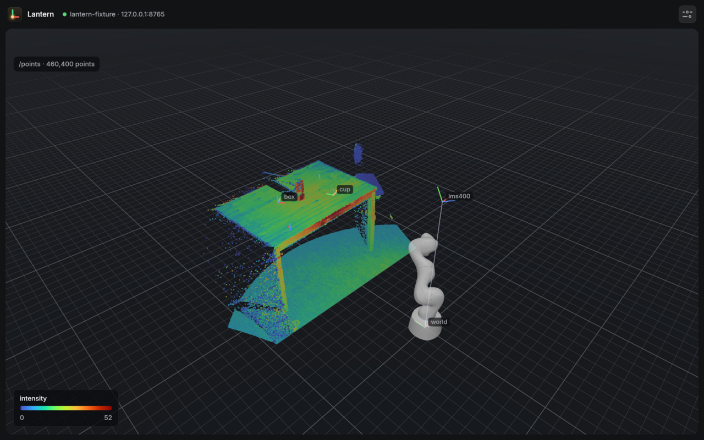

import { Aside, Steps } from '@astrojs/starlight/components';

Lantern draws a robot from a URDF file and its meshes and poses it from joint states, like
RViz's RobotModel display. The URDF is read from disk on the machine running Lantern; the joint
positions come over the same connection as everything else.


## Load a robot

<Steps>

1. Get a plain URDF. Lantern doesn't run xacro, so expand it once:

   ```sh
   xacro robot.urdf.xacro > robot.urdf
   ```

   A `.xacro` file is refused with that instruction.

2. Open **Settings → Robot**, enter the URDF's path and press **Load** (or Enter).

   The status line reports what loaded and how long it took, for example
   `med7: 10 links, 7 joints, 8 meshes · loaded in 39 ms`.

3. Publish joint states, from foxglove_bridge or an SDK app (see [below](#joint-states)).
   Until any arrive, the robot sits at the URDF's zero pose.

</Steps>

Once a robot has loaded, the side panel gets a **Robot** section with show/hide and opacity. The
path is saved, so the robot loads again on the next start. Press **Load** again after editing the
URDF or a mesh to reload it.


## Meshes

Visual geometry can be STL (binary or ASCII) meshes or the `box`, `cylinder` and `sphere`
primitives. Mesh filenames resolve the way RViz resolves them:

| Filename | Looked up |
| --- | --- |
| `meshes/link_1.stl` | Relative to the URDF |
| `/abs/path/link_1.stl`, `file:///abs/path/link_1.stl` | As given |
| `package://my_robot/meshes/link_1.stl` | `my_robot` in `ROS_PACKAGE_PATH`, then `<prefix>/share/my_robot` for each prefix in `AMENT_PREFIX_PATH`, then a directory named `my_robot` at or above the URDF (a source checkout) |

The last rule means a URDF inside its package's source tree loads without sourcing a ROS
workspace.

A mesh that can't be drawn, such as a DAE file or a missing path, is listed in red under the load
status, and the rest of the robot still draws. An unknown geometry element, or a `floating` or
`planar` joint, fails the whole load with the reason. A failed load also shows in the viewport's
status chip, for example `Robot: /nope/robot.urdf: No such file or directory (os error 2)`.

## Joint states

Lantern reads `name` and `position` from `sensor_msgs/msg/JointState`. Revolute, continuous,
prismatic and fixed joints are supported, and so is `mimic`. Names must match the URDF's joint
names.

- **ROS 2:** any `sensor_msgs/msg/JointState` topic through foxglove_bridge, such as
  `/joint_states` from your driver or `joint_state_publisher`.
- **Foxglove SDK:** Foxglove has no joint-state schema, so publish the ROS message's shape as
  JSON under its name. [Publish to Lantern](/lantern/guides/publishing/#joint-states) shows
  the channel.

**Settings → Robot → Joint states** picks the topic. **Auto** uses the first one advertised and
names it. Messages that carry only some joints merge, so separate arm and gripper publishers
work. The line under the picker says `n of m joints received`; a joint with no position yet sits
at zero. Positions outside the URDF's limits are drawn as sent, not clamped.

## Placement

The URDF's root link is placed in the fixed frame through TF when TF connects them, for example
with a static transform from `map` to the root link, or when the root is itself a TF frame such as
`world`. Otherwise the root is drawn at the fixed frame's origin, and Settings says so:
`No transform from base_link to map: drawn at map's origin`.

With **Fixed frame** on Auto and no point cloud or poses, Lantern picks the robot's root as the
fixed frame if TF knows it, else the TF tree's root, else (no TF at all) the robot's root.

<Aside>
	Lantern poses links from joint states and the URDF, not from TF. A robot whose links only appear
	on `/tf` isn't posed yet.
</Aside>

## Drawing

- Colours come from the URDF's materials, light grey where there are none.
- Normals are recomputed with a 40° crease angle, because STL normals are often unusable.
- Below 100% opacity, or with a translucent material, you see the points, grid, TF axes and poses
  behind and inside the robot, but not its own hidden faces. Lines in front of a translucent robot
  take a faint tint from it.



## Try it with the Med 7

The repo has a fixture for the KUKA LBR Med 7.
[`scripts/robot_fixture.py`](https://github.com/matthewyjiang/lantern/blob/main/scripts/robot_fixture.py)
expands a Med 7 description (a directory with `med7.urdf.xacro` and `meshes/med7/visual/`) and
copies the visual meshes into `fixtures/med7/`. It needs `xacro` (`pip install xacro`).

```sh
python scripts/robot_fixture.py path/to/robots [path/to/xacro]
/tmp/fxenv/bin/python scripts/serve.py --cloud table --robot-pose home
```

Then load `fixtures/med7/med7.urdf` in **Settings → Robot**. `--robot-pose` publishes fixed joint
states on `/joint_states`: `home` is the arm's usual home pose, and `reach` turns every joint. With
`--via ros` they go out as the ROS message through foxglove_bridge instead.

## Limits

- **Size:** up to 5,592,405 mesh vertices (1,864,135 triangles): a 128 MiB GPU buffer at 24
  bytes per vertex. A bigger model fails to load, naming the link, the count and the cap. It's
  checked before each mesh is processed. The Med 7 has 501,186.
- **Load time:** the Med 7 (8 STL files, 167 k triangles) loads in about 40 ms. Loading runs on the
  UI thread when the path changes, so that one frame is late.

Not supported yet: posing links from TF alone, the URDF sent over a topic
(`/robot_description`), collision geometry, and DAE or OBJ meshes.
