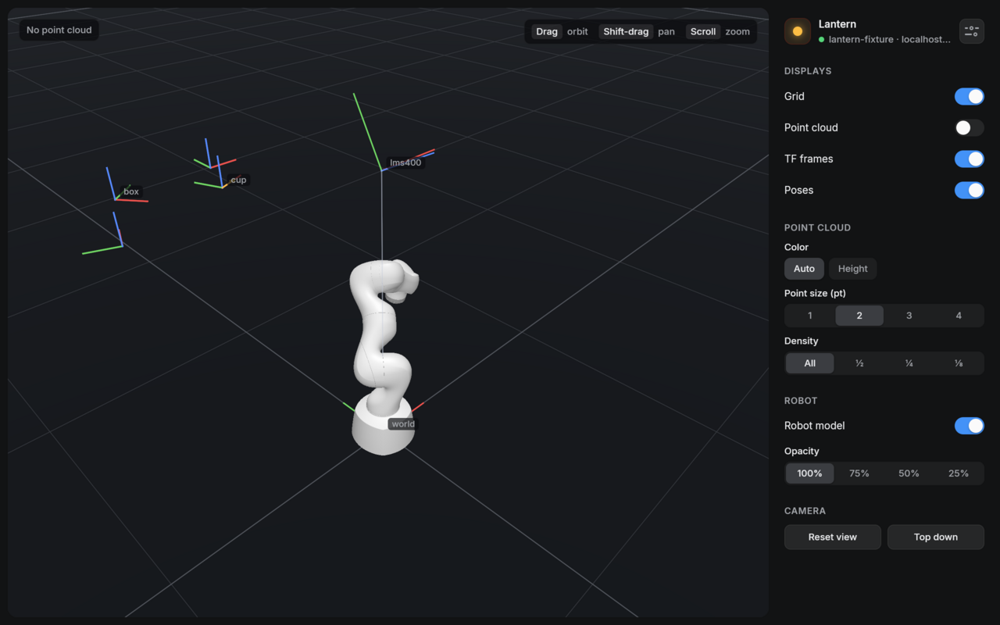
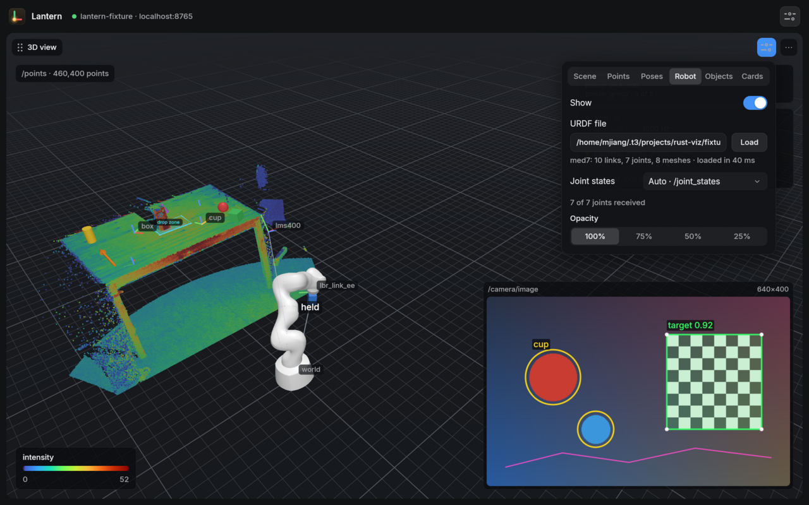
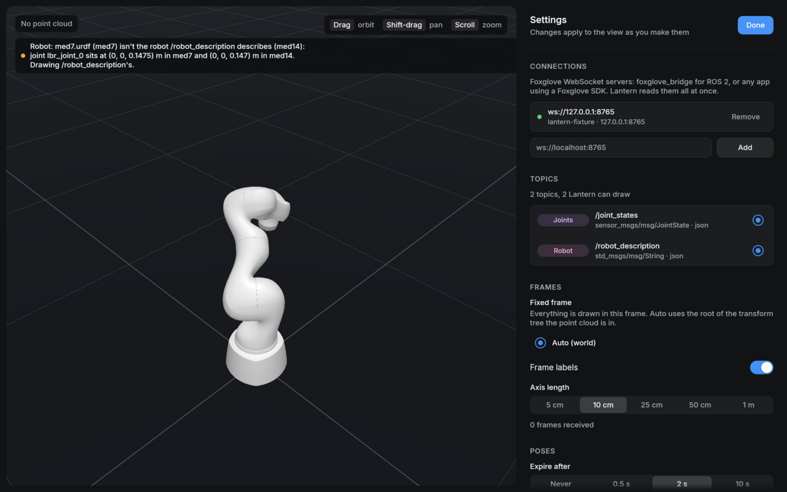

Like RViz's RobotModel display, Lantern draws a robot from a URDF and its meshes and poses it from
joint states.



## Load a URDF file

Lantern doesn't run xacro, so expand it first:

```sh
xacro robot.urdf.xacro > robot.urdf
```

Enter the path on the **Robot** tab of the 3D view's [settings](/lantern/guides/settings/#3d-view)
and press **Load**, or pass [`--urdf`](/lantern/guides/settings/#command-line) for one run. The
status line reports the result, for example `med7: 10 links, 7 joints, 8 meshes · loaded in 40 ms`.
The path is saved with the 3D view in the layout. Press **Load** again after editing the URDF or a
mesh.



## From the server

If a server publishes the URDF on a `robot_description` topic, Lantern loads it and you don't need
a file. With foxglove_bridge, that's `robot_state_publisher`'s topic; from an SDK app, see
[Publish from your code](/lantern/guides/publishing/#text-stats-and-the-robot-description).
**Description**, on the Robot tab, picks the topic if there's more than one. Lantern reads it even
with the robot hidden.

The meshes must be on Lantern's machine. Mesh paths in a received URDF should be absolute,
`file://` or `package://`: a relative path resolves against Lantern's working directory.

If you load a file and a server also describes a robot, Lantern compares the two mechanisms: the
root link, which links each joint connects, how it moves, and where it sits (to within a
micrometre). Names, visuals and colours are ignored. If they differ, Lantern draws the server's
robot and says why on the Robot tab and the status chip:

```text
Robot: med7.urdf (med7) isn't the robot /robot_description describes (med14): joint lbr_joint_0
sits at (0, 0, 0.1475) m in med7 and (0, 0, 0.147) m in med14. Drawing /robot_description's.
```

The exception: if none of the described robot's meshes load and the file's do, Lantern draws the
file's robot instead.



## Meshes

Visuals can be STL meshes (binary or ASCII) or `box`, `cylinder` and `sphere` primitives. Mesh
paths resolve the way RViz resolves them:

| Filename | Looked up |
| --- | --- |
| `meshes/link_1.stl` | Relative to the URDF |
| `/abs/path/link_1.stl`, `file:///abs/path/link_1.stl` | As given |
| `package://my_robot/meshes/link_1.stl` | `my_robot` in `ROS_PACKAGE_PATH`, then `<prefix>/share/my_robot` for each prefix in `AMENT_PREFIX_PATH`, then a directory named `my_robot` at or above the URDF |

The last rule lets a URDF inside its package's source tree load without sourcing a ROS workspace.

A mesh that can't be drawn, such as a DAE file or a missing path, is listed in red under the load
status, and the rest of the robot still draws. An unknown geometry element or a `floating` or
`planar` joint fails the whole load.

## Joint states

Lantern reads `name` and `position` from [joint state messages](/lantern/reference/topics/#schemas).
It supports revolute, continuous, prismatic and fixed joints, and `mimic`. Names must match the
URDF's joint names.

**Joint states**, on the Robot tab, picks the topic. Messages with only some of the joints are
merged, so separate arm and gripper publishers work. The line under the picker says
`n of m joints received`. A joint with no position yet sits at zero. Positions outside the URDF's
limits are drawn as sent.

## Placement

If TF connects the URDF's root link to the fixed frame, the robot stands where TF puts it. That
happens with a static transform from `map` to the root link, or when the root is itself a TF frame
such as `world`. Otherwise the root sits at the fixed frame's origin, and the Robot tab says
`No transform from base_link to map: drawn at map's origin`.

With **Fixed frame** on Auto and no point cloud or poses, the fixed frame is the robot's root if TF
knows it, else the TF tree's root, else (no TF at all) the robot's root.

Lantern poses links from joint states and the URDF, not from TF. A robot whose links only appear on
`/tf` isn't posed.

## Drawing

Colours come from the URDF's materials, or light grey. Normals are recomputed with a 40° crease
angle because STL normals are often unusable. Below 100% opacity, or with a translucent material,
the points, grid, TF axes and poses behind and inside the robot show through.


## Try it with the Med 7

The repository has fixtures for the KUKA LBR Med 7 and Med 14.
[`scripts/robot_fixture.py`](https://github.com/matthewyjiang/lantern/blob/main/scripts/robot_fixture.py)
expands their xacro descriptions and copies the visual meshes into `fixtures/med7/` and
`fixtures/med14/`. Point it at a directory with `med7.urdf.xacro`, `med14.urdf.xacro` and their
`meshes/*/visual/`, such as [pyfri](https://github.com/lunarlab-gatech/pyfri)'s `examples/robots`.
It needs `xacro` (`pip install xacro`).

```sh
python scripts/robot_fixture.py path/to/robots [path/to/xacro]
/tmp/fxenv/bin/python scripts/serve.py --robot-pose home
lantern --urdf fixtures/med7/med7.urdf
```

`serve.py` is the [replay server](/lantern/reference/replay-server/). `--robot-pose` publishes fixed
joint states on `/joint_states`: `home` is the arm's home pose and
`reach` turns every joint. To see a server's description win over the file, serve the Med 14 while
the Med 7 is loaded:

```sh
/tmp/fxenv/bin/python scripts/serve.py --cloud none --robot-pose reach \
  --robot-description fixtures/med14/med14.urdf
```

## Limits

- Up to 5,592,405 mesh vertices ([limits](/lantern/reference/topics/#limits)). The Med 7 has
  501,186.
- Loading runs on the UI thread, so the frame where it happens is late. The Med 7 (8 STL files,
  167k triangles) loads in about 40 ms.
- Not supported: posing links from TF alone, collision geometry, and DAE or OBJ meshes.
