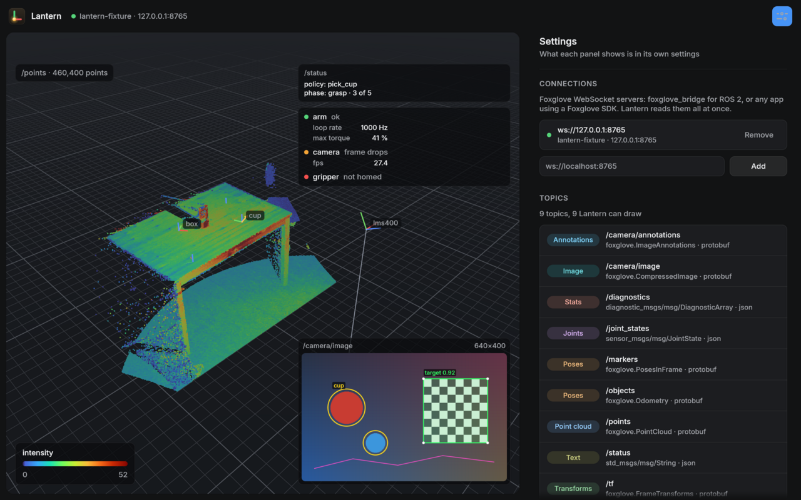
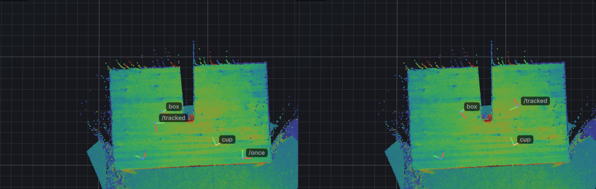

The slider button at the right of the top bar opens the **Settings** page beside the panels:
**Connections**, **Topics** and [**Layout**](/lantern/guides/layout/).



## Connections

Each [server](/lantern/connect/#servers) is green with its name when connected, amber while
connecting, and red with the error when it can't connect.

## Topics

Each advertised topic has its schema, encoding, and a badge for what Lantern draws from it. With
several servers, topics are grouped by server. The list is read-only: which topics are drawn is set
in each panel's settings.

| Badge | Used by |
| --- | --- |
| **Point cloud** | The 3D view, one topic |
| **Transforms** | Always read, every topic, so the TF tree is complete |
| **Poses** | The 3D view, each topic on or off |
| **Objects** | The 3D view, each topic on or off |
| **Joints**, **Robot** | The 3D view's robot, one topic each |
| **Image** | Each Image panel, and the 3D view's image card, one topic each |
| **Annotations** | Drawn over an image, each topic on or off per image |
| **Text**, **Stats** | Each Data panel, and the 3D view's cards, each topic on or off |
| **No decoder** | Nothing. See [Supported topics](/lantern/reference/topics/). |

Where a panel shows one topic, **Auto** (the default) uses the first one advertised. New topics
start switched on. If a message fails to decode, the error shows in red under its topic and the
topic keeps its last good message.

## Panel settings

The slider button in a 3D, Image or Data panel's header opens its settings. Press it again, press
outside, or press Escape to close them. The Topics panel has no settings.

### 3D view

| Tab | Settings |
| --- | --- |
| **Scene** | Fixed frame, grid, TF frames, labels (frame and pose names), axis length |
| **Points** | Show, topic, colour, point size, density |
| **Poses** | Show, a switch per pose topic, expire after, trail |
| **Robot** | Show, URDF file, robot description topic, joint states topic, opacity. See [Robot model](/lantern/guides/robot-model/). |
| **Objects** | Show, a switch per scene topic, and the layout's meshes with their load status. See [Objects](/lantern/guides/objects/). |
| **Cards** | The camera image card with its topic and annotations, and the text and stats cards with a switch per topic |

**Fixed frame** is the frame everything is drawn in. **Auto** shows what it picked, for example
`Auto · world`: the root of the TF tree that holds the point cloud's frame, or a pose topic's frame
when there's no cloud. With only a robot, see [Placement](/lantern/guides/robot-model/#placement).
A frame or topic you pick stays selected even when the data doesn't have it; it's listed as
`not seen yet` or `not advertised`.

| Setting | Values |
| --- | --- |
| **Axis length** | Size of TF and pose axes: 5 cm, 10 cm (default), 25 cm, 50 cm or 1 m |
| **Color** | **Auto**, **Height**, or any numeric field of the cloud (`intensity`, `ring`, ...) |
| **Point size (pt)** | 1, 2 (default), 3 or 4 |
| **Density** | All, ½, ¼ or ⅛ of the points |
| **Expire after** | **Never**, 0.5 s, 2 s (default) or 10 s |
| **Trail** | **Off** (default), 5 s, 15 s or 60 s |

**Auto** colour uses the first of these that the cloud has: packed `rgb`/`rgba`, separate
`red`/`green`/`blue` fields, `intensity`, then height. Numeric fields are mapped through the Turbo
colour map over their 1st to 99th percentile, so a few outliers don't wash out the rest. The legend
at the bottom left of the viewport shows the field and its range.

Hiding the point cloud also unsubscribes from it, as switching off a pose or scene topic does.

**Expire after** removes a pose its topic hasn't sent again within that time. **Trail** draws where
each pose has been over that time.



**Cards.** Without an Image panel in the layout, the 3D view draws the camera image as a card in its
lower right corner, set like an Image panel. Without a Data panel, it draws text and stats cards at
its top right, set like a Data panel. With both panels in the layout, there's no **Cards** tab.

### Image

**Image topic** picks the camera, and **Annotations** has a switch per annotation topic drawn over
it.

### Data

**Text** and **Stats** turn each on or off. While one is on, it has a switch per topic.

## settings.json

Settings are stored in `$XDG_CONFIG_HOME/lantern/settings.json` (by default
`~/.config/lantern/settings.json`). You can edit it while Lantern is closed. The default:

```json title="~/.config/lantern/settings.json"
{
  "connections": ["ws://localhost:8765"],
  "layout": { "panel": "3d" }
}
```

Each panel's settings sit beside its `"panel"` key, in the
[layout format](/lantern/guides/layout/#layout-files).

Every key is checked. If the file doesn't parse (an unknown key, a wrong type, a mistake in the
layout), Lantern prints why on stderr, copies the file to `settings.json.bak` next to it (or
`.bak.1`, `.bak.2`, ... so an earlier backup stays), and starts with the defaults. Fix the copy
and put it back while Lantern is closed. If the copy fails, Lantern doesn't save that run.

### Panel keys

A dot is a nested key: `points.size` is written `"points": { "size": 3 }`.

| `3d` key | Default | Meaning |
| --- | --- | --- |
| `fixed_frame` | `null` | The fixed frame; `null` is Auto |
| `grid`, `frames`, `labels` | `true` | Grid, TF frames, frame and pose labels |
| `axis_length` | `0.1` | TF and pose axis length, in metres |
| `points.show` | `true` | |
| `points.topic` | `null` | `null` is Auto |
| `points.color` | `"Auto"` | `"Auto"`, `"Height"`, or a field like `{"Field": "intensity"}`. A cloud without the field is coloured by height. |
| `points.size` | `2` | In points |
| `points.decimate` | `1` | Draw every n-th point |
| `poses.show` | `true` | |
| `poses.hidden` | `[]` | Pose topics switched off |
| `poses.timeout` | `2` | Seconds; `0` never expires |
| `poses.trail` | `0` | Seconds; `0` draws no trail. Capped at 60. |
| `robot.show` | `true` | |
| `robot.urdf` | `""` | The URDF file; empty for none |
| `robot.description_topic`, `robot.joint_topic` | `null` | `null` is Auto |
| `robot.opacity` | `1` | 0 to 1 |
| `objects.show` | `true` | Scene topics and the layout's meshes |
| `objects.hidden` | `[]` | Scene topics switched off |
| `objects.meshes` | `[]` | Mesh files attached to TF frames; see [Meshes in the layout](/lantern/guides/objects/#meshes-in-the-layout) |
| `image_card` | `true` | The camera image card |
| `image` | | What the card shows, with an `image` panel's keys |
| `data` | | The text and stats cards, with a `data` panel's keys |

| `image` key | Default | Meaning |
| --- | --- | --- |
| `topic` | `null` | `null` is Auto |
| `hidden` | `[]` | Annotation topics not drawn over the image |

| `data` key | Default | Meaning |
| --- | --- | --- |
| `text`, `stats` | `true` | Text and stats on or off |
| `hidden` | `[]` | Text and stats topics not shown |

A `topics` panel takes no keys.

### Files from earlier versions

Lantern doesn't convert old files. One with the view settings at the top level (`robot_urdf`,
`cloud_topic`, `hidden_topics`, `show_image`, ...) doesn't parse, so it's backed up and Lantern
starts with the defaults. Redo your settings in the app, or move each into its panel:
`"robot_urdf": "/path/arm.urdf"` becomes `"robot": { "urdf": "/path/arm.urdf" }` on the `3d` panel.

## Command line

| Flag | Effect |
| --- | --- |
| `--connect URL` | Read this server instead of the saved list. Repeat for more servers. |
| `--urdf PATH` | Draw this URDF in the 3D view. Lantern warns if the layout has no 3D view. |
| `--layout NAME\|PATH` | Use this [preset or layout file](/lantern/guides/layout/#layout-files). A preset keeps the saved layout's panel settings; a file is used as it is. |
| `--version` | Print the version and exit. |

Other flags go to Rune, the UI library, for headless runs; see
[Test a change](/lantern/reference/architecture/#test-a-change).

`--connect`, `--urdf` and `--layout` apply to one run and aren't saved, unless you change the same
thing during the run:

- If you change the servers, the list is saved as you left it.
- If you change a panel's settings during a `--layout` run, your saved layout keeps its tiling and
  takes the change. If you change the tiling (split, close, resize, a preset), the layout is saved
  as you left it.
- A `--urdf` file is never saved. The 3D view keeps the URDF it had before, unless you load a
  different one.
