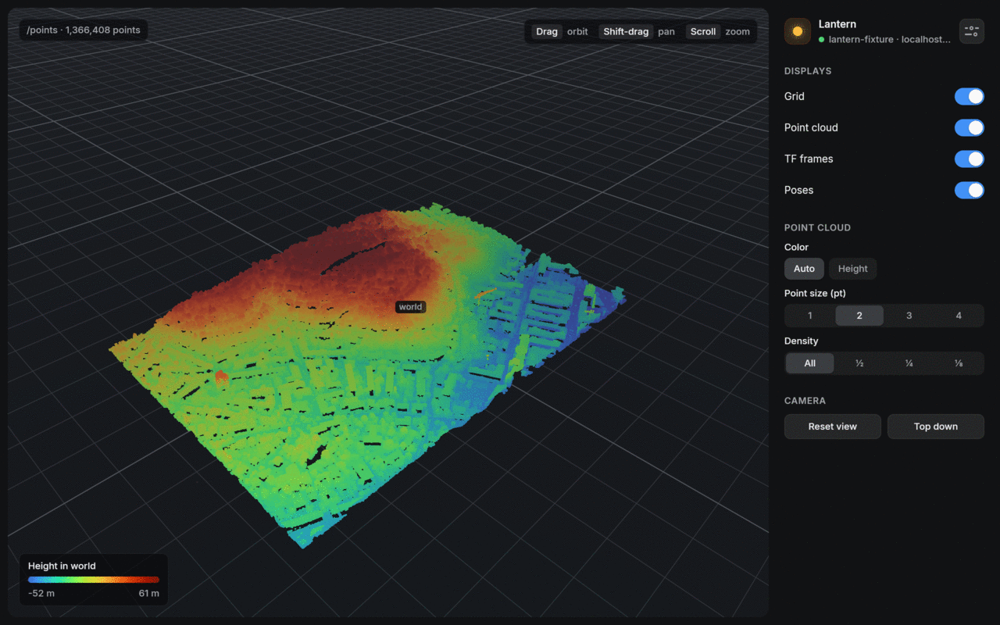

Lantern holds 60 fps with a 1.37 M-point cloud arriving 10 times a second. The 3D pass for that
cloud takes about half a millisecond of GPU time.



## Setup

- **GPU:** RTX PRO 5000 Blackwell, driver 595.99, headless.
- **Viewport:** 1948×1560 px (`--scale 2`).
- **Data:** the 1,366,408-point terrain scan, served live by `scripts/serve.py`. The cloud is sent
  once, when Lantern subscribes, except in the ingest row.
- **Method:** `scripts/bench.sh 3`: three trials per row, each 600 frames paced at 60 Hz
  (`--realtime`). Spread across trials is ≤ 0.002 ms on GPU p50.

## Results

| Config | Points drawn | Rune CPU/frame p50 | GPU 3D pass p50 (p95) |
| --- | --- | --- | --- |
| All points, 2 pt | 1,366,408 | 0.10–0.18 ms | 0.495 (0.521) ms |
| ½ density | 683,204 | 0.17–0.18 ms | 0.262 (0.279) ms |
| ¼ density | 341,602 | 0.18 ms | 0.149 (0.159) ms |
| Points off (sky, grid, TF) | 0 | 0.18 ms | 0.033 (0.036) ms |
| 1 pt points | 1,366,408 | 0.17–0.18 ms | 0.394 (0.416) ms |
| 4 pt points | 1,366,408 | 0.17–0.18 ms | 1.087 (1.096) ms |
| All points + PNG readback every frame | 1,366,408 | 0.16 ms | 0.492 (0.515) ms |
| All points, new cloud at 10 Hz | 1,366,408 | 0.18 ms (p95 9.4–9.5 ms) | 0.492 (0.516) ms |
| All points + robot (Med 7, 501,186 vertices) | 1,366,408 | 0.18 ms | 0.511–0.515 (0.535–0.538) ms |
| Robot only, points off | 0 | 0.18 ms | 0.062 (0.065–0.066) ms |

## Reading the numbers

- **CPU** is Rune's own `frame cpu` line: update, view, layout, Lantern's encode, and submit. A
  frame without a new cloud doesn't re-upload it; it records one draw call.
- **GPU** comes from timestamp queries around the 3D pass only, on frames that drew the final
  point count. The UI pass and any readback are outside them, which the readback row confirms:
  GPU time is unchanged while wall time per frame rises to a 59–75 ms p95 for PNG encoding.
- **It's linear in points.** 0.033 ms with none, plus 0.338 ms per million points. That line
  predicts the ½ and ¼ rows within 0.002 ms.
- **60 fps held.** Every paced run delivered 600 frames in 9.98 s. The largest gap between frame
  starts was 22.9 ms, and none passed 25 ms, which would mean a missed slot. That includes the
  ingest row: 97 uploads of a 1.37 M-point cloud in a 10 s run.
- **Ingesting a cloud** costs its frame 5.5–6.0 ms to copy 21.9 MB into the GPU buffer, plus about
  1 ms to rebuild the display. Decoding, including the colour range, happens on the WebSocket
  thread.
- **The robot** adds 0.029 ms on its own and 0.017–0.020 ms on top of the full cloud. Loading the
  URDF is a one-time 41 ms, on the frame it loads.
- **Clocks:** the GPU ran at about 1.6 GHz (maximum 3.09 GHz), so these are not peak-clock
  numbers. On-screen presentation isn't measured.

## What bounds the point draw

Each point is six vertices (two triangles) pulled from a storage buffer in one draw call. At small
point sizes the vertex front end dominates: going from 1 pt to 2 pt quadruples the pixels per
point but adds only 0.10 ms, and 1 pt is still 0.36 ms over the empty scene. At 2 pt, 8.2 M vertex
invocations take 0.46 ms, about 18 G/s. At 4 pt, fill takes over: four times the pixels again
costs 0.59 ms more.

An earlier version drew each point as a 4-vertex instance, which took twice as long for the same
image.

## Run it yourself

```sh
scripts/bench.sh 3      # timing table → out/bench.tsv, raw logs in out/bench/
```

Headless runs take Rune's tooling flags, for example `--frames 240` to time 240 frames with no
readback. Each run ends with Rune's CPU timing and Lantern's GPU timestamps.
