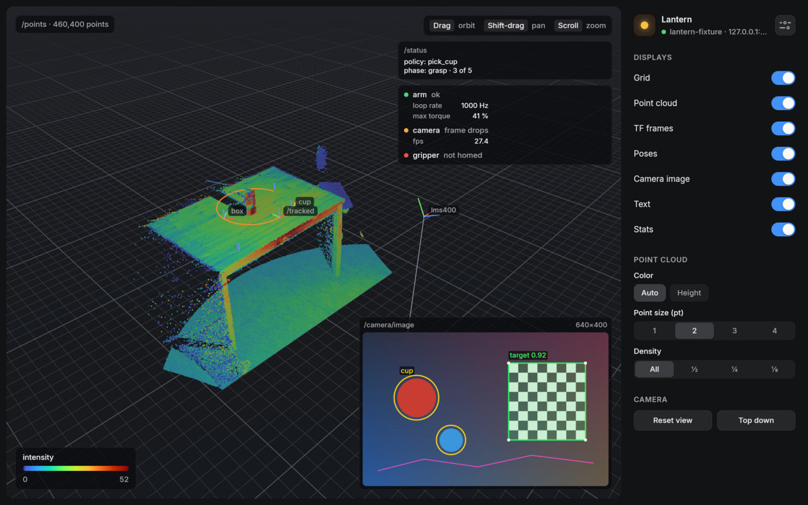

Lantern decodes a channel when it knows its (encoding, schema) pair. Everything else is listed in
**Settings → Topics** as **No decoder** and never subscribed to.

## Schemas

| Kind | ROS 2 via foxglove_bridge (`cdr`) | Foxglove SDK (`protobuf`) |
| --- | --- | --- |
| Point cloud | `sensor_msgs/msg/PointCloud2` | `foxglove.PointCloud` |
| Transforms | `tf2_msgs/msg/TFMessage`, `geometry_msgs/msg/TransformStamped` | `foxglove.FrameTransform`, `foxglove.FrameTransforms` |
| Poses | `geometry_msgs/msg/PoseStamped`, `geometry_msgs/msg/PoseArray`, `nav_msgs/msg/Odometry` | `foxglove.PoseInFrame`, `foxglove.PosesInFrame`, `foxglove.Odometry` |
| Joint states | `sensor_msgs/msg/JointState` | `foxglove.JointStates`, or `sensor_msgs/msg/JointState` as `json` (see [Publish to Lantern](/lantern/guides/publishing/#joint-states)) |
| Robot description | `std_msgs/msg/String` on a topic named `robot_description` or `…/robot_description` | The same, as `json` |
| Camera image | `sensor_msgs/msg/Image`, `sensor_msgs/msg/CompressedImage` | `foxglove.RawImage`, `foxglove.CompressedImage` |
| Image annotations | | `foxglove.ImageAnnotations` |
| Text | `std_msgs/msg/String` | The same, as `json` |
| Stats | `diagnostic_msgs/msg/DiagnosticArray` | The same, as `json` |

"As `json`" means a JSON channel whose schema is named after the ROS type, for messages Foxglove
has no schema of its own for. Lantern decodes by schema name, so it doesn't need the schema text
the server sends. Foxglove's `json`-encoded versions of its own schemas aren't read; the SDKs'
typed channels send protobuf.

## How each kind is drawn

**Point clouds.** One cloud topic is drawn at a time, chosen in Settings (the first advertised
until you choose), from whichever server sends it. Points with a non-finite coordinate are dropped. Colour comes from packed
`rgb`/`rgba`, `red`/`green`/`blue` fields, `intensity`, or height; see
[Display settings](/lantern/guides/settings/#display).

**Transforms.** Every transform topic is read, including `/tf_static`, into one TF tree. Each
frame is drawn as RGB axes (x red, y green, z blue) with an optional name label.

**Poses.** Each pose is drawn as axes. Odometry adds its name (`child_frame_id` from ROS,
`body_frame_id` from Foxglove) and its linear velocity as an arrow showing one second of motion.
Each pose topic can be switched off in Settings. An Odometry topic keeps one pose per name, so a
publisher can send one message per tracked object on a single topic. A pose its topic hasn't sent
again within **Expire after** (2 s by default) is removed, and **Trail** draws where each pose has
been; both are in [Settings → Poses](/lantern/guides/settings/#poses).

**Joint states.** Not drawn on their own; they pose the
[robot model](/lantern/guides/robot-model/#joint-states). Lantern reads `name` and `position`.
A message with no positions at all (a driver that reports only effort) is accepted and ignored;
one with some but not all is an error. `foxglove.JointStates` joints without a position are
skipped.

**Robot description.** The URDF as text, which Lantern loads as the
[robot model](/lantern/guides/robot-model/#from-the-server). Only a topic named `robot_description`
(or ending in `/robot_description`) is read this way; any other `std_msgs/msg/String` topic is text.

**Camera images.** One image topic is shown at a time, in a card at the viewport's bottom right,
at most 480 px wide. Compressed images are JPEG, PNG or WebP. Raw images can be `rgb8`, `bgr8`,
`rgba8`, `bgra8`, `mono8` or `mono16`; anything else is refused with that list.

**Image annotations.** Drawn over the shown image: circles, points, line strips, loops and line
lists, and text. Circles and loops with a fill colour are filled. A points annotation of an unknown type is skipped,
and the message's other shapes still draw.

**Text.** Each text topic gets a card at the viewport's top right, with the message's first 10
lines.

**Stats.** Every status of every `DiagnosticArray` topic is listed in one card, coloured by
level, with its key-value pairs.

## What Lantern assumes

- **Newest wins.** Lantern draws the newest message on each topic. Timestamps are ignored, and
  there's no buffering or time sync.
- **Poses expire.** A pose not refreshed within **Expire after** is removed, so an object a
  publisher stops sending disappears. Set it to **Never** to keep poses until their topic goes
  away.
- **Servers merge by topic.** With several servers, topics of the same name feed one display.
  Transforms from every server join one TF tree.
- **A slow UI drops clouds, not TF.** If the UI falls behind a fast publisher, it skips straight
  to the newest cloud per topic. Transforms, poses and joints are applied in arrival order.

## Limits

Each limit is reported where you'd look when it's hit.

| Limit | Value | Why | When hit |
| --- | --- | --- | --- |
| Points per cloud | 8,388,608 | The 128 MiB storage binding Rune's GPU device allows, at 16 bytes per point | The cloud isn't drawn; its topic shows the count and the cap |
| Message size | 256 MiB | 5.6 M points at Ouster's 48-byte point step | The connection fails with tungstenite's `Message too long: N > 268435456` as its status |
| Robot mesh vertices | 5,592,405 | The same 128 MiB binding, at 24 bytes per vertex | The robot doesn't load; the status names the link, the count and the cap |
| Image side | 8,192 px | Checked before decoding, so a bad header can't allocate gigabytes | The image isn't shown; the status chip and its topic show the size and the cap |
| Text cards, stats | 3 cards, 6 statuses | About the viewport's height beside Settings in a 1280×800 window | An `and N more` line says how many are hidden; hide topics in Settings → Topics |
| Pose trail | 60 s | The longest option; every trail is redrawn whole on each display rebuild | A longer `trail` in settings.json is clamped, with a note on stderr |

## Adding a message type

One row in a table and one function; see
[Architecture → Add a message type](/lantern/reference/architecture/#add-a-message-type).
